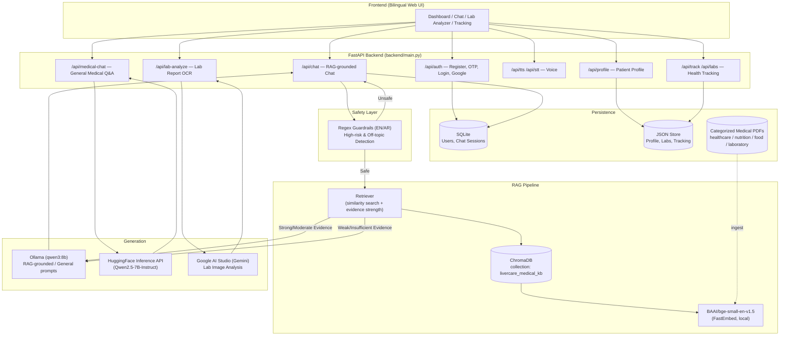

# LiverCare AI

### Personalized, Evidence-Grounded AI Assistant for Fatty Liver Disease Patients

[](https://www.python.org/)
[](https://fastapi.tiangolo.com/)
[](https://www.langchain.com/)
[](https://www.trychroma.com/)
[](#limitations)

> LiverCare AI is a Retrieval-Augmented Generation (RAG) system that gives patients with **fatty liver disease (MASLD/NAFLD)** grounded, cited, bilingual (Arabic/English) answers drawn from curated medical literature — instead of unreliable, unsourced information from the open internet.

---

## 📑 Table of Contents

- [Overview](#-overview)
- [Problem & Solution](#-problem--solution)
- [Key Features](#-key-features)
- [System Architecture](#-system-architecture)
- [How It Works](#-how-it-works)
- [Technology Stack](#-technology-stack)
- [Project Structure](#-project-structure)
- [Installation](#-installation)
- [Environment Configuration](#-environment-configuration)
- [Data Ingestion](#-data-ingestion)
- [Running the Project](#-running-the-project)
- [REST API Reference](#-rest-api-reference)
- [RAG Pipeline](#-rag-pipeline)
- [Safety & Reliability](#-safety--reliability)
- [Data Sources](#-data-sources)
- [Testing & Evaluation](#-testing--evaluation)
- [Limitations](#-limitations)
- [Future Roadmap](#-future-roadmap)
- [Disclaimer](#-disclaimer)

---

## 🔎 Overview

LiverCare AI is a **Day 1 prototype** of a medical RAG system built specifically for patients living with **Metabolic Dysfunction-Associated Steatotic Liver Disease (MASLD)**, also known as fatty liver disease. It ingests peer-reviewed medical PDFs (clinical guidelines, journal research, case studies), indexes them in a vector database, and answers patient questions with citations back to the exact source document and page.

The system is bilingual (Arabic RTL / English LTR), runs its retrieval and embedding pipeline fully offline/local by default, and includes an explicit safety layer that refuses high-risk medical requests (diagnosis, prescriptions, medication changes) in favor of directing the patient to a healthcare professional.

## ❓ Problem & Solution

**Problem:** Fatty liver disease affects a large and growing global patient population. Many patients turn to unreliable internet sources for guidance, which can lead to confusion, anxiety, or harmful self-treatment decisions.

**Solution:** LiverCare AI provides a safe, evidence-based assistant that:

- Retrieves information only from a curated set of trusted medical sources
- Generates answers grounded in retrieved evidence, with citations
- Supports both Arabic and English, including everyday Egyptian Arabic phrasing
- Uses simple, patient-friendly language
- Clearly refuses high-risk medical requests (diagnosis, medication changes)
- Is explicit that it never replaces a qualified healthcare professional

## ✨ Key Features

### 🧠 RAG & Retrieval
- **Category-based PDF ingestion** — medical documents are organized into `healthcare`, `nutrition`, `food`, `laboratory`, and `other` categories, each with dedicated metadata
- **Page-level parsing** with `pypdf`, preserving document name, page number, and source category per chunk
- **Recursive, section-aware chunking** via `langchain-text-splitters` with configurable chunk size/overlap
- **Local embeddings** using `BAAI/bge-small-en-v1.5` (FastEmbed) — free, no external API required — with optional OpenAI embeddings support
- **Persistent ChromaDB vector store** with similarity-score-based retrieval
- **Evidence-strength classification** (`strong` / `moderate` / `weak` / `insufficient`) that decides whether the model answers from retrieved context (with citations) or falls back to general knowledge (without fabricated citations)

### 💬 Conversational AI
- **Hybrid RAG + LLM chat endpoint** — Ollama-based local generation (`qwen3:8b` by default) with Qwen "thinking mode" disabled and output-cleaning to strip leaked prompts/artifacts
- **Separate general medical Q&A endpoint** via the Hugging Face Inference API for open-ended liver/medical conversation, with strict language-matching rules (Egyptian Arabic, Modern Standard Arabic, or English)
- **Bilingual prompt templates** tuned separately for RAG-grounded and general-knowledge answering modes

### 🔬 Lab Report Analysis
- **Image-based lab report analyzer** powered by Google AI Studio (Gemini) — extracts test names, values, units, reference ranges, and flags Normal/High/Low status directly from an uploaded photo of a lab report, with plain-language health advice

### 🔐 Authentication
- **Email/password registration** with **6-digit OTP email verification** (10-minute expiry, 20-second resend cooldown)
- **Google Sign-In** account linking
- **Bcrypt password hashing** and a custom **HMAC-SHA256 signed JWT** implementation for session tokens
- **SQLAlchemy-backed user store** (SQLite by default) with chat session and chat message tables

### 📋 Patient Profile & Tracking
- **Patient profile** (name, age, sex, weight, height, diabetes/hypertension flags, activity level) with automatic BMI calculation
- **Health tracking log** for weight, activity, and notes over time
- **Lab entry log** for recording individual test results

### 🛡️ Safety Layer
- **Regex-based bilingual guardrails** (English + Arabic) that intercept high-risk requests — medication changes, diagnosis requests, treatment recommendations — before they reach the LLM
- **Off-topic filtering** to keep the assistant focused on fatty liver, nutrition, lifestyle, and lab-related questions
- **Citation suppression on weak evidence** — the system never shows citations it cannot actually support

### 🌐 Bilingual UI
- Full Arabic (RTL) / English (LTR) interface with a language toggle, served directly by the FastAPI backend
- Dashboard, AI Assistant chat, Medical Chat, Lab Analyzer, Health Tracking, and Settings views

## 🏗️ System Architecture



## ⚙️ How It Works

1. **Ingestion (offline, run once or on demand):** PDFs placed under `data/healthcare`, `data/nutrition`, `data/food`, and `data/laboratory` are loaded page-by-page, split into overlapping text chunks, embedded locally, and stored in a persistent ChromaDB collection.
2. **User asks a question** in Arabic or English through the chat UI.
3. **Safety check:** the question is screened against bilingual regex patterns for high-risk medical requests (diagnosis, medication, treatment) and off-topic content. Unsafe questions are intercepted with a fixed, professional response and never reach the LLM.
4. **Retrieval:** the question is embedded and compared against the vector store. The top candidates are deduplicated by source document and classified into an evidence-strength tier based on similarity scores.
5. **Context construction:** for `strong`/`moderate` evidence, retrieved chunks are formatted into a context block (capped at a max character budget) alongside per-chunk citation metadata.
6. **Generation:** the question (plus context, if applicable) is sent to a bilingual system prompt and generated via a local Ollama model. Model output is cleaned of leaked prompt artifacts, thinking tags, and boilerplate before being returned.
7. **Citations:** if evidence was strong/moderate, deduplicated citations (document name, page number, relevance score, category) are attached to the response. If evidence was weak/insufficient, no citations are shown and the model answers from general knowledge with an explicit caveat.
8. **Response:** the final answer, citations, and a safety notice (if applicable) are returned to the frontend and rendered in the patient's chosen language.

## 🧰 Technology Stack

| Category | Technologies |
|---|---|
| **Language** | Python 3.10+, TypeScript |
| **Backend Framework** | FastAPI, Uvicorn |
| **RAG Orchestration** | LangChain, langchain-community, langchain-chroma, langchain-text-splitters |
| **Vector Database** | ChromaDB (persistent local store) |
| **Embeddings** | FastEmbed — `BAAI/bge-small-en-v1.5` (local, optional OpenAI embeddings) |
| **PDF Parsing** | pypdf |
| **LLM (Chat)** | Ollama (`qwen3:8b`, local), Hugging Face Inference API (`Qwen2.5-7B-Instruct`) |
| **Vision (Lab OCR)** | Google AI Studio / Gemini API |
| **Authentication** | bcrypt, custom HMAC-SHA256 JWT, SQLAlchemy ORM |
| **Data Storage** | SQLite (users, chat sessions), JSON files (profile, labs, tracking) |
| **Frontend** | HTML5, CSS3 (RTL/LTR), vanilla JavaScript |
| **Config / Env** | python-dotenv |

## 📁 Project Structure

```text
LiverCare-AI/
├── backend/
│   ├── main.py                  # FastAPI app assembly, routers, static file serving
│   ├── config.py                # Central configuration & environment-driven settings
│   ├── security.py              # Bcrypt hashing, custom JWT, OTP generation
│   ├── email_service.py         # OTP email dispatch (SMTP or console fallback)
│   │
│   ├── ai/
│   │   ├── llm.py               # Ollama integration, output cleaning, fallback answers
│   │   ├── prompts.py           # Bilingual RAG & general-knowledge system prompts
│   │   └── safety.py            # Regex-based bilingual safety guardrails
│   │
│   ├── rag/
│   │   ├── loader.py            # Category-aware PDF loading with page-level metadata
│   │   ├── chunker.py           # Recursive character-based chunking
│   │   ├── embeddings.py        # Local (FastEmbed) / OpenAI embedding provider
│   │   ├── vectorstore.py       # ChromaDB creation, querying, deletion
│   │   ├── retriever.py         # Similarity search + evidence-strength classification
│   │   ├── citations.py         # Citation filtering & formatting
│   │   └── ingest.py            # End-to-end ingestion pipeline (load → chunk → embed)
│   │
│   ├── api/
│   │   ├── auth.py              # Register, OTP verify/resend, login, Google auth, me
│   │   ├── chat.py              # Hybrid RAG + LLM chat endpoint
│   │   ├── medical_chat.py      # General medical Q&A (Hugging Face)
│   │   ├── lab_analyzer.py      # Lab report image analysis (Gemini)
│   │   ├── voice.py             # Voice capability endpoints (browser Speech API)
│   │   ├── profile.py           # Patient profile CRUD + BMI calculation
│   │   └── tracking.py          # Health tracking & lab entry CRUD
│   │
│   └── database/
│       ├── database.py          # Lightweight JSON-file storage (profile, labs, tracking)
│       ├── auth_db.py           # SQLAlchemy models: User, ChatSession, ChatMessage
│       └── models.py            # Pydantic request/response schemas
│
├── frontend/
│   ├── index.html               # Main bilingual single-page UI
│   ├── styles.css               # RTL/LTR styling
│   ├── app.js                   # Frontend application logic
│   └── assets/                  # Additional static assets
│
├── data/
│   ├── healthcare/              # Clinical guideline & journal PDFs
│   ├── nutrition/               # Nutrition & diet-related PDFs
│   ├── food/                    # Food-related reference PDFs
│   ├── laboratory/              # Lab methodology / biomarker PDFs
│   ├── raw/                     # Originally sourced PDFs
│   └── store/                   # Runtime JSON storage (profile, labs, tracking)
│
├── scripts/
│   ├── ingest_all.py            # Full ingestion entry point
│   ├── test_retrieval.py        # Retrieval smoke tests
│   ├── test_all.py              # End-to-end pipeline tests
│   └── ...                      # Additional ingestion/debugging utilities
│
├── eval/
│   ├── Day1_Retrieval_Test_Set.csv  # Curated retrieval evaluation questions
│   └── Day1_Safety_Test_Cases.csv   # Curated safety-layer evaluation cases
│
├── tests/                       # Reserved for automated test suite
├── DATA_SOURCES.md              # Full inventory of ingested/ignored documents
├── CODE_GUIDE_AR.md             # Arabic-language walkthrough of the codebase
├── requirements.txt             # Python dependencies
├── .env.example                 # Environment variable template
└── run.bat / start_server.bat   # Windows launch scripts

> **Note:** the repository root also contains a separate, standalone Vite/React/TypeScript prototype (`src/`, `server.ts`, `index.html`, `style.css`) built around the Google Gemini API with a hardcoded clinical knowledge base. This is an independent exploratory UI and is not part of the FastAPI/RAG backend described above.

## 🚀 Installation

### Prerequisites

- **Python 3.10+**
- **[Ollama](https://ollama.com/)** running locally (for chat generation) with the `qwen3:8b` model pulled, or an OpenAI-compatible key configured
- Optional: a **Hugging Face** token (general medical chat) and a **Google AI Studio** API key (lab report analysis)

### Clone the Repository

```bash
git clone https://github.com/AhmedIbrahim144/RAG-FINAL.git
cd RAG-FINAL
```

### Install Dependencies

```bash
python -m venv .venv
.venv\Scripts\activate      # Windows
# source .venv/bin/activate # macOS/Linux

pip install -r requirements.txt
```

## 🔧 Environment Configuration

Copy the example file and fill in your values:

```bash
copy .env.example .env      # Windows
# cp .env.example .env      # macOS/Linux
```

| Variable | Default | Description |
|---|---|---|
| `EMBEDDING_PROVIDER` | `local` | `local` (FastEmbed, free) or `openai` |
| `LLM_PROVIDER` | `ollama` | LLM backend for the RAG chat endpoint |
| `OLLAMA_BASE_URL` | `http://localhost:11434` | Local Ollama server URL |
| `OLLAMA_MODEL` | `qwen3:8b` | Ollama model used for chat generation |
| `OPENAI_API_KEY` | — | Required only if using OpenAI as LLM/embedding provider |
| `OPENAI_CHAT_MODEL` | `gpt-4o-mini` | OpenAI chat model (if enabled) |
| `HF_TOKEN` | — | Hugging Face token for the general medical chat endpoint |
| `HF_MEDICAL_MODEL` | `Qwen/Qwen2.5-7B-Instruct` | Hugging Face model used for general Q&A |
| `GOOGLE_API_KEY` | — | Google AI Studio key for the lab report analyzer (Gemini) |
| `JWT_SECRET` | — | **Required.** Secret used to sign authentication tokens |
| `JWT_ALGORITHM` | `HS256` | JWT signing algorithm |
| `JWT_EXPIRATION_SECONDS` | `604800` | Token lifetime (default: 7 days) |
| `SMTP_HOST` / `SMTP_PORT` / `SMTP_USER` / `SMTP_PASS` | — | Optional SMTP settings for sending OTP emails (falls back to console logging if unset) |
| `FROM_EMAIL` | `noreply@livercare.internal` | Sender address for OTP emails |

> `backend/security.py` will raise a `RuntimeError` at startup if `JWT_SECRET` is not set — this variable is mandatory.

## 📥 Data Ingestion

Medical PDFs are organized into category folders under `data/` (`healthcare`, `nutrition`, `food`, `laboratory`, `other`). To build (or rebuild) the vector index:

```bash
python scripts/ingest_all.py
```

This runs the full pipeline: load PDFs page-by-page → chunk with overlap → generate local embeddings → persist to ChromaDB. The pipeline can also be triggered at runtime via `POST /api/rebuild-index`.

Per `DATA_SOURCES.md`, the initial curated "Day 1" corpus consisted of **12 processed documents** covering AASLD/EASL clinical guidance, NAFLD research, and metabolic risk studies (229 pages → 890 chunks), with 28 additional documents from the original source explicitly excluded as out of scope (e.g. viral hepatitis, transplantation, liver cancer, editorial content). The `data/` directory structure supports incremental growth of the corpus within each category.

## ▶️ Running the Project

### Start the Backend (serves the frontend as well)

```bash
python -m uvicorn backend.main:app --host 0.0.0.0 --port 8000 --reload
```

Then open **`http://localhost:8000`** in your browser — the FastAPI app serves the bilingual frontend directly (`frontend/index.html`, `styles.css`, `app.js`).

### Windows Quick-Start

```bat
run.bat
```

`run.bat` checks for Python, installs dependencies, runs ingestion automatically if no vector store is found, and starts the server.

## 🔌 REST API Reference

### Chat & Medical AI

| Method | Endpoint | Description |
|---|---|---|
| `POST` | `/api/chat` | Hybrid RAG + LLM chat with citations (`ChatRequest` → `ChatResponse`) |
| `POST` | `/api/medical-chat` | General medical Q&A via Hugging Face, no retrieval, strict language matching |
| `POST` | `/api/lab-analyze` | Analyzes a base64 lab report image via Gemini and returns structured results |
| `POST` | `/api/tts` | Text-to-speech instruction (delegates to browser Web Speech API) |
| `POST` | `/api/stt` | Speech-to-text instruction (delegates to browser Web Speech API) |
| `GET` | `/api/voice-capabilities` | Reports available voice features |

### Patient Data

| Method | Endpoint | Description |
|---|---|---|
| `GET` | `/api/profile` | Retrieve the current patient profile |
| `POST` | `/api/profile` | Save/update profile; auto-computes BMI when weight & height are present |
| `GET` | `/api/track` | Retrieve all health tracking entries |
| `POST` | `/api/track` | Add a new tracking entry (weight, activity, notes) |
| `GET` | `/api/labs` | Retrieve all recorded lab entries |
| `POST` | `/api/labs` | Add a new lab result entry |

### Authentication

| Method | Endpoint | Description |
|---|---|---|
| `POST` | `/api/auth/register` | Register with full name, email, password; sends OTP email |
| `POST` | `/api/auth/verify-otp` | Verify the 6-digit OTP and receive a session token |
| `POST` | `/api/auth/resend-otp` | Resend OTP (enforces a 20-second cooldown) |
| `POST` | `/api/auth/login` | Email/password login, returns a signed session token |
| `POST` | `/api/auth/google` | Register/login via Google account details |
| `GET` | `/api/auth/me` | Fetch the authenticated user's profile |

### System

| Method | Endpoint | Description |
|---|---|---|
| `GET` | `/health` | Basic service health check |
| `POST` | `/api/rebuild-index` | Triggers a full re-ingestion of the vector store |

**Example — `POST /api/chat`:**

```json
{
  "question": "What lifestyle changes help with fatty liver?",
  "lang": "en",
  "top_k": 6
}
```

## 🧠 RAG Pipeline

- **Document ingestion:** `pypdf` extracts text per page from category-organized PDF folders, attaching `document_name`, `page_number`, `source_type`, and `category` metadata to each page.
- **Chunking:** `RecursiveCharacterTextSplitter` splits text using a `["\n\n", "\n", ". ", " ", ""]` separator hierarchy, configurable via `CHUNK_SIZE`/`CHUNK_OVERLAP`, and assigns a unique `chunk_id` (`{document}-p{page}-c{index}`) per chunk.
- **Embeddings:** local `BAAI/bge-small-en-v1.5` via FastEmbed by default (OpenAI embeddings supported as an alternative).
- **Vector storage:** persistent ChromaDB collection (`livercare_medical_kb`).
- **Retrieval:** fetches a wide candidate pool (`RETRIEVAL_CANDIDATES`), filters by a minimum relevance threshold, deduplicates by source document (keeping the highest-scoring chunk per document), and returns the top-`k` results.
- **Evidence-strength classification:** results are labeled `strong` (top score ≥ 0.70 with ≥2 supporting chunks), `moderate` (top score ≥ 0.50 with ≥2 supporting chunks), `weak` (above the base confidence threshold), or `insufficient`.
- **Context construction:** retrieved chunks are formatted with source labels and truncated to a maximum character budget (`MAX_CONTEXT_CHARS`) before being passed to the LLM.
- **Citation handling:** citations are only attached to the response when evidence is `strong` or `moderate`; they are deduplicated per source document and include the document name, page number, relevance score, and category.
- **Generation:** a bilingual, evidence-strength-aware prompt (RAG-grounded vs. general-knowledge) is sent to a local Ollama model; output is post-processed to strip thinking tags, leaked instructions, and boilerplate prefixes.

## 🛡️ Safety & Reliability

- **High-risk request interception:** bilingual regex patterns (English + Arabic) detect requests to start/stop/change medication, requests for a diagnosis or prognosis, and requests for drug recommendations — these are intercepted **before** reaching the LLM and answered with a fixed, professional referral message.
- **Off-topic filtering:** questions unrelated to fatty liver, nutrition, lifestyle, or lab interpretation (e.g. politics, sports, weather) are declined with a scope-clarifying message.
- **No fabricated citations:** when retrieval evidence is weak or insufficient, the system explicitly avoids presenting citations and answers from general knowledge instead, with an honesty caveat built into the prompt.
- **Password & token security:** passwords are hashed with salted bcrypt (12 rounds); session tokens are signed with HMAC-SHA256 and verified via constant-time comparison.
- **OTP protection:** OTP codes expire after 10 minutes and resends are rate-limited to one per 20 seconds.
- **This system explicitly cannot:** diagnose diseases, prescribe medication, tell patients to start/stop/change medication, replace a doctor, or generate unsupported medical claims.

## 📚 Data Sources

The knowledge base is built from category-organized medical PDFs (`data/healthcare`, `data/nutrition`, `data/food`, `data/laboratory`). The original curated Day 1 corpus (documented in [`DATA_SOURCES.md`](DATA_SOURCES.md)) draws on sources including:

- AASLD Practice Guidance on the clinical assessment of MASLD
- EASL–EASD–EASO Clinical Practice Guidelines on MASLD management
- Peer-reviewed research on sex-specific associations, cardiometabolic risk, genetic risk factors, and emerging therapeutics (e.g. FGF21 agonists) in fatty liver disease
- Clinical scoring system studies (e.g. the PAGED-B score) and case reports

`DATA_SOURCES.md` also documents the exclusion criteria used to filter out 28 unrelated documents (viral hepatitis, liver transplantation, liver cancer, journal administrative content) from the original source set, keeping the corpus scoped to fatty liver disease.

## 🧪 Testing & Evaluation

```bash
# Test retrieval quality
python scripts/test_retrieval.py

# Full pipeline test (English + Arabic + safety)
python scripts/test_all.py
```

The repository also includes curated evaluation sets under `eval/`:

- **`Day1_Retrieval_Test_Set.csv`** — hand-written retrieval questions labeled by category (e.g. medical definition, diagnostic criteria, lifestyle recommendations, lab interpretation) with expected retrieval difficulty
- **`Day1_Safety_Test_Cases.csv`** — curated cases for validating the safety guardrail layer

## ⚠️ Limitations

- This is an early-stage ("Day 1") prototype, not a production medical system.
- The `tests/` directory currently contains no automated test cases beyond a placeholder module; validation currently relies on the `scripts/test_*.py` utilities and the `eval/` CSV sets.
- Chat generation depends on a locally running Ollama instance; if unavailable, the system falls back to a plain evidence dump or a generic "insufficient information" message rather than a fully generated answer.
- The English embedding model (`BAAI/bge-small-en-v1.5`) is not natively multilingual, so relevance scoring for Arabic queries is comparatively weaker than for English queries.
- Patient data (profile, labs, tracking) is stored in flat JSON files rather than a relational schema, which does not scale to multi-user production use.
- No automated evaluation metrics (Precision@k, Recall@k) are currently computed — the `eval/` CSVs exist as manually curated test sets rather than an automated scoring pipeline.
- No license file is currently included in the repository.

## 🗺️ Future Roadmap

- [x] PDF ingestion with category-based organization and page-level metadata
- [x] Local embeddings + ChromaDB retrieval with evidence-strength classification
- [x] Bilingual (Arabic/English) safety guardrails
- [x] Email/OTP + Google authentication
- [x] Lab report image analysis via Gemini
- [ ] Advanced evaluation metrics (Precision@k, Recall@k) computed automatically from `eval/`
- [ ] Hybrid search (dense + sparse retrieval)
- [ ] Multilingual/cross-lingual embedding model for stronger Arabic retrieval
- [ ] Persistent multi-turn conversation memory tied to `ChatSession`/`ChatMessage`
- [ ] Migration of profile/labs/tracking storage from JSON files to a relational database
- [ ] Automated CI test suite under `tests/`

## ⚖️ Disclaimer

This is a prototype system for informational purposes only. It is **not** a licensed medical device and does not provide diagnosis, prescribing guidance, or emergency treatment. All information should be reviewed by a qualified healthcare professional before making any medical decision. Always consult a doctor for personal medical care.

---

**Built with:** FastAPI, LangChain, ChromaDB, FastEmbed, pypdf, Ollama, SQLAlchemy

Next time, try this in Cowork
